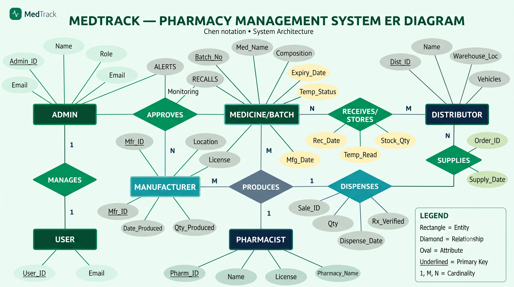
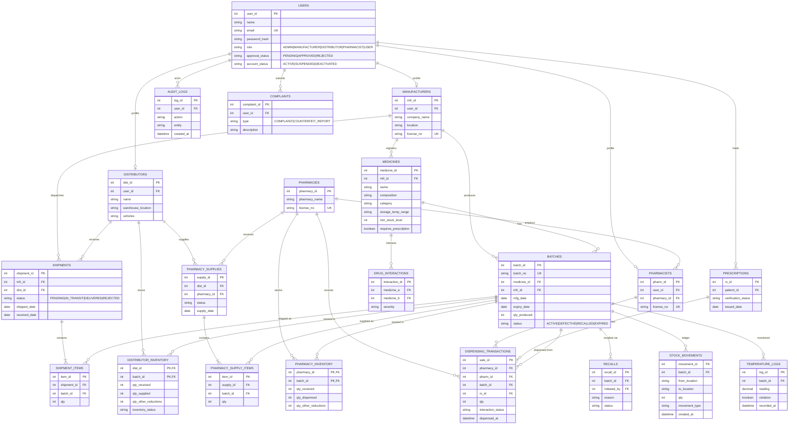

# MedTrack — Pharmaceutical Supply Chain Management System

MedTrack is a database-driven platform that tracks every medicine batch from the **manufacturer** to the **distributor** to the **pharmacy** and finally to the **patient (user)**. Each unit is traceable at batch level, stock is updated only through verified transactions, and an **Admin** governs accounts, recalls and audits.

---

## 1. ER Diagram (Chen Notation)



> **Setup note:** save the diagram image as `images/medtrack-er-diagram.png` next to this README so the image above renders.

### How to read the diagram

| Symbol | Meaning |
|---|---|
| Rectangle | Entity (ADMIN, USER, MANUFACTURER, MEDICINE/BATCH, DISTRIBUTOR, PHARMACIST) |
| Diamond | Relationship (APPROVES, MANAGES, PRODUCES, RECEIVES/STORES, SUPPLIES, DISPENSES) |
| Oval | Attribute |
| Underlined oval | Primary key |
| 1, M, N | Cardinality |

### Relationships in the diagram

| Relationship | Between | Cardinality | Meaning |
|---|---|---|---|
| **MANAGES** | Admin → User | 1 : 1 (conceptually 1 : N) | Admin creates, edits, suspends and deactivates accounts |
| **APPROVES** | Admin → Manufacturer | 1 : N | Admin approves registrations and monitors alerts and recalls |
| **PRODUCES** | Manufacturer → Medicine/Batch | M : N | A manufacturer produces many medicines; a medicine can be made by many manufacturers. Carries `Date_Produced`, `Qty_Produced` |
| **RECEIVES/STORES** | Medicine/Batch ↔ Distributor | N : M | Distributor receives batches and stores them. Carries `Rec_Date`, `Stock_Qty`, `Temp_Read` |
| **SUPPLIES** | Distributor → Pharmacy side | 1 : N | Distributor supplies pharmacies. Carries `Order_ID`, `Supply_Date` |
| **DISPENSES** | Pharmacist → Medicine/Batch | 1 : N | Pharmacist dispenses to users. Carries `Sale_ID`, `Qty`, `Rx_Verified`, `Dispense_Date` |

---

## 2. System Architecture

```
┌──────────────────────────────────────────────────────────────┐
│  Presentation layer   Role-based dashboards (Admin,          │
│                       Manufacturer, Distributor, Pharmacist, │
│                       User)                                  │
├──────────────────────────────────────────────────────────────┤
│  Application layer    REST API · authentication · RBAC       │
│                       server-side validation · business rules│
├──────────────────────────────────────────────────────────────┤
│  Data layer (DBMS)    Relational DB · constraints · ACID     │
│                       transactions · triggers · audit log    │
└──────────────────────────────────────────────────────────────┘
```

Key principle: **the database is the source of truth**. The UI never computes stock; it only displays what the database holds, and every rule (no overselling, no recalled stock, unique batch numbers) is enforced in the backend and the DB, not just in the interface.

### Actors

| Role | Scope |
|---|---|
| **Admin** | System-wide: approvals, users, recalls, thresholds, reports, audit log |
| **Manufacturer** | Own medicines, batches, production, dispatches, defect and recall requests |
| **Distributor** | Own warehouse: receive, verify, store, supply pharmacies, temperature logs, quarantine |
| **Pharmacist** | Own pharmacy: receive stock, verify prescriptions, check interactions, dispense |
| **User** | Search medicines, check batch and recall status, own history, complaints |

---

## 3. DBMS Architecture

### 3.1 Logical schema (relational ER)

The Chen diagram is a conceptual model. In the relational implementation, the combined **MEDICINE/BATCH** entity is split into `medicines` and `batches`, and the M:N relationships become **junction/transaction tables**. A `pharmacies` table is also added so that stock belongs to a pharmacy rather than to an individual pharmacist.



### 3.2 Entity-to-table mapping from the Chen diagram

| Chen entity / relationship | Relational tables |
|---|---|
| ADMIN, USER, MANUFACTURER, DISTRIBUTOR, PHARMACIST | `users` (with a `role` column) plus profile tables `manufacturers`, `distributors`, `pharmacists` |
| MEDICINE/BATCH | `medicines` (the product definition) and `batches` (a produced lot with batch number, dates and quantity) |
| PRODUCES (M:N) | `batches.mfr_id` and `batches.medicine_id`; one row per production lot |
| RECEIVES/STORES | `shipments`, `shipment_items`, `distributor_inventory`, `temperature_logs` |
| SUPPLIES | `pharmacy_supplies`, `pharmacy_supply_items`, `pharmacy_inventory` |
| DISPENSES | `dispensing_transactions`, `prescriptions` |
| APPROVES, MANAGES | `users.approval_status`, `users.account_status`, `audit_logs` |
| RECALLS, ALERTS | `recalls`, `alerts` (generated from thresholds, expiry and temperature rules) |

### 3.3 Cardinalities implemented

- Manufacturer → Batches: **1 : N**
- Medicine → Batches: **1 : N**
- Manufacturer → Distributor Shipments: **1 : N**
- Distributor → Warehouse Inventory rows: **1 : N**
- Distributor → Pharmacy Supplies: **1 : N**
- Pharmacy → Dispensing Transactions: **1 : N**
- Pharmacist → Dispensing Transactions: **1 : N**
- Batch → Inventory and Shipment rows: **1 : N**
- Admin → Audit Logs: **1 : N**
- Batch → Recalls: **1 : N**

### 3.4 Keys and constraints

- **Primary keys** on every table; composite PKs on inventory tables, such as `(dist_id, batch_id)` and `(pharmacy_id, batch_id)`.
- **Foreign keys** on every relationship, with `ON DELETE RESTRICT` so history cannot be orphaned.
- **Unique:** `batches.batch_no`, `users.email`, and licence numbers.
- **CHECK constraints:** quantities `>= 0`, `expiry_date > mfg_date`, and `qty_supplied <= qty_received` at each stage.
- **Soft delete only:** records are deactivated, recalled or marked, never silently deleted.

Example DDL:

```sql
CREATE TABLE batches (
  batch_id     SERIAL PRIMARY KEY,
  batch_no     VARCHAR(50) UNIQUE NOT NULL,
  medicine_id  INT NOT NULL REFERENCES medicines(medicine_id),
  mfr_id       INT NOT NULL REFERENCES manufacturers(mfr_id),
  mfg_date     DATE NOT NULL,
  expiry_date  DATE NOT NULL,
  qty_produced INT  NOT NULL CHECK (qty_produced > 0),
  status       VARCHAR(20) NOT NULL DEFAULT 'ACTIVE',
  CHECK (expiry_date > mfg_date)
);

CREATE TABLE distributor_inventory (
  dist_id              INT REFERENCES distributors(dist_id),
  batch_id             INT REFERENCES batches(batch_id),
  qty_received         INT NOT NULL DEFAULT 0 CHECK (qty_received >= 0),
  qty_supplied         INT NOT NULL DEFAULT 0 CHECK (qty_supplied >= 0),
  qty_other_reductions INT NOT NULL DEFAULT 0 CHECK (qty_other_reductions >= 0),
  PRIMARY KEY (dist_id, batch_id),
  CHECK (qty_supplied + qty_other_reductions <= qty_received)
);
```

### 3.5 Quantity calculations (derived, never double counted)

| Stage | Formula |
|---|---|
| Manufacturer remaining | `qty_produced − SUM(qty dispatched)` |
| Distributor available | `qty_received − qty_supplied − qty_other_reductions` |
| Pharmacy available | `qty_received − qty_dispensed − qty_other_reductions` |
| Total medicine stock | Sum of **valid** available stock at each location |
| Manufacturer production | `SUM(qty_produced)` over the manufacturer's batches |

A shipment **moves** stock between locations; it does not create new medicine. Totals are therefore computed from current location balances, never by adding "produced + received + dispensed" together.

```sql
CREATE VIEW v_batch_stock AS
SELECT b.batch_id, b.batch_no,
       b.qty_produced - COALESCE(s.shipped,0)            AS at_manufacturer,
       COALESCE(d.dist_stock,0)                          AS at_distributors,
       COALESCE(p.pharm_stock,0)                         AS at_pharmacies
FROM batches b
LEFT JOIN (SELECT batch_id, SUM(qty) shipped FROM shipment_items GROUP BY batch_id) s USING (batch_id)
LEFT JOIN (SELECT batch_id, SUM(qty_received-qty_supplied-qty_other_reductions) dist_stock
           FROM distributor_inventory GROUP BY batch_id) d USING (batch_id)
LEFT JOIN (SELECT batch_id, SUM(qty_received-qty_dispensed-qty_other_reductions) pharm_stock
           FROM pharmacy_inventory GROUP BY batch_id) p USING (batch_id);
```

### 3.6 Transactions (ACID)

Every stock-changing action is one atomic database transaction with row-level locking.

**Example: distributor supplies a pharmacy**

1. `BEGIN`
2. Lock the inventory row: `SELECT ... FROM distributor_inventory WHERE dist_id=? AND batch_id=? FOR UPDATE`
3. Check the batch is not `RECALLED`, `DEFECTIVE` or expired.
4. Check available quantity `>= requested`; otherwise `ROLLBACK`.
5. Increase `qty_supplied`.
6. Insert into `pharmacy_supply_items` and upsert `pharmacy_inventory`.
7. Insert into `stock_movements` and `audit_logs`.
8. `COMMIT`

The same pattern applies to manufacturer dispatch, distributor receipt and pharmacy dispensing. `FOR UPDATE` prevents two concurrent requests from overselling the same stock.

### 3.7 Stock movement ledger

`stock_movements` is an append-only ledger (batch, from, to, quantity, type, timestamp). It provides full batch-level traceability: for any batch you can reconstruct exactly where every unit went.

### 3.8 Business rules enforced in the DB and backend

- Cannot dispatch, supply or dispense more than available (no negative stock).
- Recalled, defective, quarantined or expired batches are blocked from further movement.
- Prescription-only medicines require a verified prescription at dispensing.
- Drug-interaction lookup against `drug_interactions` before dispensing.
- Temperature readings outside the medicine's storage range create a violation record and an alert.
- Low-stock alerts when available stock falls below `min_stock_level`; near-expiry alerts by configurable threshold.

### 3.9 Medicine status derivation

| Status | Rule |
|---|---|
| Recalled | An active recall exists for the batch |
| Expired | `expiry_date < today` |
| Near Expiry | `expiry_date` within the configured window |
| Low Stock | Available stock below `min_stock_level` |
| Active | None of the above |

(Precedence: Recalled → Expired → Near Expiry → Low Stock → Active.)

### 3.10 Recall flow

1. Manufacturer or Admin creates a `recalls` record for a batch.
2. Batch status becomes `RECALLED`; further movement is blocked.
3. Recursive trace through `stock_movements` finds every distributor and pharmacy holding the batch.
4. Alerts are sent to those holders; stock is quarantined, not deleted.
5. Admin can follow resolution through audit history.

### 3.11 Security and access control

- **RBAC enforced on the backend**, with each request checked against role and organisation (a manufacturer can only touch rows where `mfr_id` is its own).
- Passwords stored as salted hashes (bcrypt/argon2); authenticated sessions or tokens.
- Registration approval workflow via `approval_status`.
- Users can see only their own prescriptions and dispensing history.
- Credentials and API keys stay on the server and are never exposed in frontend code.
- Every sensitive action writes to `audit_logs` (who, what, when), and the log is searchable by Admin.

### 3.12 Indexing for performance

```sql
CREATE UNIQUE INDEX idx_batch_no          ON batches(batch_no);
CREATE INDEX idx_batch_expiry             ON batches(expiry_date);
CREATE INDEX idx_batch_medicine           ON batches(medicine_id);
CREATE INDEX idx_movements_batch_time     ON stock_movements(batch_id, created_at);
CREATE INDEX idx_dispense_pharmacy_date   ON dispensing_transactions(pharmacy_id, dispensed_at);
CREATE INDEX idx_audit_user_time          ON audit_logs(user_id, created_at);
```

---

## 4. Role Dashboards

| Role | Highlights |
|---|---|
| **Admin** | Totals for users, manufacturers, distributors, pharmacists, medicines, batches; alerts for expiry, recall, low stock, temperature; approvals; recalls; CSV export; audit log; thresholds |
| **Manufacturer** | Company profile and licence; medicines; batches; production and dispatch reports; defect reporting; recall requests |
| **Distributor** | Incoming shipments; verify and accept; warehouse stock by batch; pharmacy orders; temperature readings; quarantine; damage reports |
| **Pharmacist** | Available stock; receive from distributors; prescription check; interaction check; dispense; history; restock requests |
| **User** | Medicine search and composition; batch and recall status; own history; profile; complaints and counterfeit reports |

---

## 5. Data Flow

```
Manufacturer ──(shipment)──▶ Distributor ──(supply)──▶ Pharmacy ──(dispense)──▶ User
     │                           │                         │
     └──────────── every step: stock_movements + audit_logs ┘
                          Admin monitors, approves and recalls
```

---

## 6. Suggested Project Structure

```
medtrack/
├── README.md
├── images/
│   └── medtrack-er-diagram.png
├── database/
│   ├── schema.sql
│   ├── migrations/
│   └── seed_demo_data.sql      # clearly labelled demo data
├── backend/
│   ├── routes/ · controllers/ · middleware/ (auth, RBAC, validation)
│   └── services/ (inventory, recall, alerts)
└── frontend/
    └── dashboards/ (admin, manufacturer, distributor, pharmacist, user)
```

---

## 7. Testing Checklist

- [ ] Duplicate batch number is rejected
- [ ] Dispatch above available quantity is rejected
- [ ] Concurrent supply requests cannot oversell stock
- [ ] Recalled or expired batches cannot be shipped or dispensed
- [ ] Prescription-only medicine cannot be dispensed without verification
- [ ] A manufacturer cannot read or edit another manufacturer's data
- [ ] A user cannot open staff dashboards or see others' prescriptions
- [ ] Every sensitive action appears in the audit log
- [ ] Dashboard totals match the sum of database records

---

## 8. Summary

MedTrack uses a normalised relational schema with enforced keys and constraints, atomic ACID transactions with row locking for every stock change, an append-only movement ledger for batch-level traceability, and backend role-based access control with a full audit trail. The result is a supply chain where each unit can be traced from production to dispensing, and stock counts at every stage can be verified against real records.
